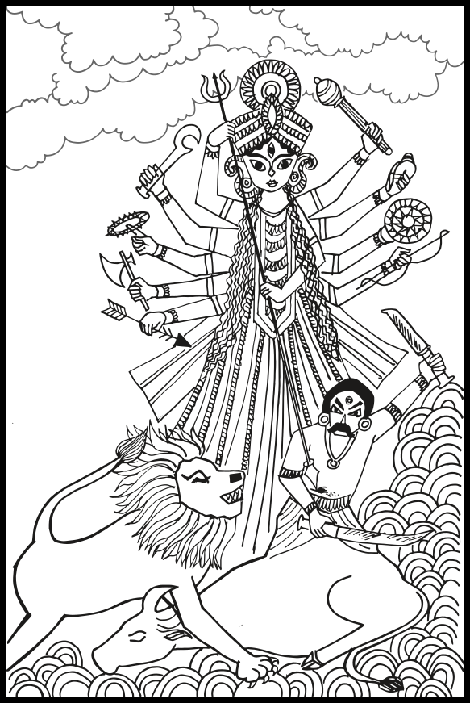

# মহিষাসুরের উপাখ্যান {.unnumbered}

---

পুরাকালে বৈবস্বত মনুর সময়ে মহিষাসুর নামে অসুরদের এক রাজা ছিল, আর দেবতাদের রাজা ছিলেন ইন্দ্র। সে সময়ে দেবতা আর অসুরদের মধ্যে ভীষণ যুদ্ধ বাধলো। একশ’ বছর যুদ্ধ চলার পর দেবতারা হেরে গেলেন। দেবতাদের তাড়িয়ে দিয়ে মহিষাসুরই স্বর্গের রাজা হয়ে বসলো। নিরুপায় হয়ে দেবতারা তখন ব্রহ্মাকে সঙ্গে নিয়ে বিষ্ণু আর শিবের কাছে গিয়ে নিজেদের দুঃখের কথা বর্ণনা করে বললেন, ‘দুরাত্মা মহিষাসুর সূর্য, ইন্দ্র, অগ্নি, বায়ু, যম, বরুণ প্রভৃতি দেবতার ক্ষমতা কেড়ে নিয়েছে। দেবতারা এখন শক্তিহীন হয়ে মানুষের মতো পৃথিবীতে ঘুরে বেড়াচ্ছেন। এখন আমরা আপনাদের শরণ নিলাম। আপনারা মহিষাসুরকে বধ করবার কোনো উপায় করে আমাদের রক্ষা করুন।’

দেবতাদের মুখে মহিষাসুরের অত্যাচারের কথা শুনে বিষ্ণু আর মহাদেবের ভীষণ রাগ হলো। রাগে তাঁদের চেহারা ভয়ংকর হয়ে উঠলো। সঙ্গে সঙ্গে প্রথমে বিষ্ণুর, পরে শিব ও ব্রহ্মার মুখ থেকে প্রচণ্ড তেজ বেরিয়ে আসতে লাগলো। ক্রমে দেখা গেল ইন্দ্র প্রভৃতি সব দেবতার মুখ থেকেই বিপুল জ্যোতি বেরিয়ে আসছে। বিষ্ণু, ব্রহ্মা, শিব এবং অন্যান্য দেবতাদের দেহের এই তেজ ধীরে ধীরে একসঙ্গে মিলে একটা জ্বলন্ত পর্বতের মতো দেখাতে লাগলো। আস্তে আস্তে দেখা গেল এই তেজের পুঞ্জ এক জ্যোতির্ময়ী দেবীর মূর্তি ধারণ করছে। মহাদেবের তেজ থেকে ফুটে উঠলো সেই দেবীর মুখ, বিষ্ণুর তেজ থেকে বাহু, ব্রহ্মার তেজ থেকে পা, যমের তেজে তৈরি হলো চুল, চন্দ্রের তেজে বুক, ইন্দ্রের তেজে শরীরের মধ্যভাগ, সূর্যের তেজে পায়ের আঙ্গুল, অষ্টবসুর তেজে হাতের আঙ্গুল, আর অগ্নির তেজে সৃষ্টি হলো সেই দেবীর তিনটি চোখ। এই রকম ভাবে প্রত্যেক দেবতার তেজে দেবীর শরীরের কোনো না কোনো অংশ সৃষ্টি হলো, আর সকল দেবতার মিলিত তেজে রূপ পেয়ে যিনি আবির্ভূতা হলেন তিনিই চণ্ডী, তিনিই দুর্গা।

{width=100%}

চণ্ডীদেবীকে রূপ ধারণ করতে দেখে দেবতাদের খুবই আনন্দ হলো। মহাদেব নিজের শূল থেকে ঠিক সেই রকম আর একটি শূল সৃষ্টি করে দেবীকে দিলেন। বিষ্ণু দিলেন নিজের সুদর্শন চক্র থেকে সৃষ্টি করে অনুরূপ একটি চক্র। বরুণ দিলেন শঙ্খ, অগ্নি দিলেন শক্তি, পবন দিলেন ধনুক আর বাণে ভরা দুটি তূণ, দেবরাজ ইন্দ্র দিলেন বজ্র, যম দিলেন কালদণ্ড, জল দেবতা দিলেন পাশ, ব্রহ্মা দিলেন রুদ্রাক্ষের মালা আর কমণ্ডলু, তা ছাড়া কালের দেবতার কাছ থেকে দেবী পেলেন একটি খড়্গ আর একটি ঝক্‌ঝকে ঢাল এবং বিশ্বকর্মার কাছ থেকে পেলেন একটি ধারালো কুঠার, একটা অভেদ্য কবচ, আরও নানারকম অস্ত্র। অস্ত্রশস্ত্র ছাড়া অনেক অলংকারও দেবতারা দেবীকে দিলেন। ক্ষীরোদ সাগর দিল মুক্তোর মালা, দু’খানি চমৎকার শাড়ি, উজ্জ্বল একটি মুকুট, একজোড়া কুণ্ডল, হাতের বালা, কপালের টিকলি, বাহুর বাজু, পায়ের নূপুর, গলার হার আর আংটি। সমুদ্র দিল পদ্মের মালা আর শঙ্খ। হিমালয় দিল দেবীর বাহন একটা সিংহ, কুবের দিলেন মধুর পানীয়ে ভরা এমন একটি পানপাত্র যা কখনো খালি হয় না। নাগরাজ বাসুকি দিলেন মহামণি খচিত একটি নাগহার। তা ছাড়া অন্যান্য দেবতাদের কাছ থেকে দেবী আরো অনেক বসনভূষণ পেলেন। 

বসনভূষণ আর অস্ত্রশস্ত্রে সেজে দেবী ভীষণ জোরে হেসে উঠলেন, সেই হাসির আওয়াজে সমস্ত আকাশ ভরে গেল, পৃথিবী কেঁপে উঠলো, আর দেবতারা সকলে দেবীর জয়ধ্বনি করে উঠলেন।

সেই ভীষণ শব্দ শুনে অসুরেরা ভাবলো ব্যাপার কী? তাড়াতাড়ি তারা সৈন্যসামন্ত সাজাতে আরম্ভ করে দিলে। আঃ কী আওয়াজ বলে মহিষাসুর স্বয়ং সৈন্য নিয়ে সেই আওয়াজের দিকে ছুটে গিয়ে দেখলো দেহের জ্যোতিতে সমস্ত দিক্ আলো করে অস্ত্রশস্ত্রে সেজে এক দেবী দাঁড়িয়ে আছেন। দেবীকে দেখেই ভীষণ রেগে মহিষাসুর তাঁকে আক্রমণ করলো। রথী, গজারোহী, অশ্বারোহী আর পদাতিক, এই চার রকম অসংখ্য সৈন্য নিয়ে চিকুর ও চামর নামে মহিষাসুরের দুজন সেনাপতি দেবীর সঙ্গে যুদ্ধ করতে এগিয়ে এলো। এ ছাড়া উদগ্র আর মহাহনু নামে আরো দুজন বড় বড় অসুর সেনাপতি ষাট হাজার সৈন্য আর এক কোটি রথ নিয়ে যুদ্ধ করতে এলো। অসিলোমা, বাস্কলাসুর, পারিবারিত, বিড়ালাক্ষ প্রভৃতি দৈত্য সেনাপতিরা আরো কত যে সৈন্যসামন্ত নিয়ে যুদ্ধে নামলো তার লেখাজোখা নেই। আর অসুরদের অস্ত্রই বা ছিল কতরকম। তোমর (শাবল), ভিন্দিপাল (ছুঁড়ে মারবার অস্ত্র), শক্তি (বর্শা), মুষল, খড়্গ, পরশু (কুঠার), পট্টিশ (এক রকম তরোয়াল) ইত্যাদি নানা রকম অস্ত্র নিয়ে তারা দেবীর সঙ্গে যুদ্ধ করতে লাগলো। কিন্তু এতগুলি অসুর সৈন্যের সঙ্গে দারুণ যুদ্ধ করেও দেবীর মুখে একটুও কষ্ট বা পরিশ্রমের চিহ্ন দেখা গেল না। অসুরদের তিনি নিজে তো মারতে লাগলেনই, তাঁর বাহন সিংহও রাগে কেশর ফুলিয়ে অসংখ্য অসুর বধ করতে লাগলো। তা ছাড়া দেবীর নিশ্বাস থেকে লক্ষ লক্ষ গণ বা দেবী সৈন্য জন্মালো, আর জন্মেই তারা অসুর মারতে শুরু করে দিলে।

দেবীর সঙ্গে যুদ্ধে অসুরদের যে দুর্গতি হলো তা আর বলবার নয়। কতকগুলি অসুর তো দেবীর ঘণ্টার আওয়াজেই মরে গেল। কেউ খড়্গের আঘাতে, কেউ বা গদা, ত্রিশূল, শক্তি, বাণ ইত্যাদি নানা অস্ত্রে মারা পড়তে লাগলো। গণেরা পটহ (ঢাক), শঙ্খ, মৃদঙ্গ প্রভৃতি বাজাতে শুরু করে দিলে। অসুরদের কারুর হাত, কারুর বা মাথা কাটা পড়লো। কারুর এক পা, এক হাত কিংবা এক চোখ গেল। কিন্তু এত মার খেয়েও অসুর সৈন্যরা প্রাণপণে যুদ্ধ করতে লাগলো। সেই যুদ্ধক্ষেত্র ভাঙা রথ, মরা হাতী, ঘোড়া আর অসুরদের মৃতদেহে ভরে উঠলো। আগুন যেমন কাঠ পোড়ায় তেমনি অল্পক্ষণের মধ্যেই দেবী সমস্ত অসুর সৈন্য মেরে ফেললেন। দেবীর এই ভীষণ যুদ্ধ দেখে সিংহ কেশর ফুলিয়ে গর্জন করে উঠলো, দেবতারা পুষ্পবৃষ্টি করলেন।

সৈন্যদের মৃত্যু দেখে দৈত্য সেনাপতি চিকুর নিজে এগিয়ে এসে দেবীকে বাণ মারতে লাগলো। কিন্তু দেবী অনায়াসেই সে-সব বাণ কেটে ফেললেন, উপরন্তু চিকুরের রথের ঘোড়া আর তার সারথিকে মেরে ফেললেন, তার ধ্বজা আর ধনুক কেটে দিলেন, আর তার সমস্ত শরীর বাণ মেরে ক্ষতবিক্ষত করে দিলেন। ঘোড়া নেই, রথ নেই, চিকুর তখন খড়্গ আর ঢাল নিয়েই ছুটে গিয়ে সিংহের মাথায় আর দেবীর হাতে কোপ বসালো। কিন্তু দেবীর হাতে লেগে খড়্গ ভেঙে টুকরো টুকরো হয়ে গেল। রাগে চোখ লাল করে চিকুর তখন দেবীর দিকে এক ভয়ংকর শূল ছুঁড়ে মারলো। তাই দেখে দেবী চিকুরের দিকে এমন এক শূল ছুঁড়লেন যে তা চিকুরের শুলটাকে কেটে ফেলে অসুর সেনাপতির শরীরটাকে একশ খণ্ড করে দিলে।

চিকুরের মৃত্যু দেখে হাতীর পিঠে চড়ে চামরাসুর এগিয়ে এল। সেও দেবীর দিকে এক শক্তি ছুঁড়ে মারলো। কিন্তু দেবীর এক হুংকারেই সে শক্তি ভেঙে পড়ে গেল। এরপর চামর আরো অনেক অস্ত্রশস্ত্র ছুঁড়ে মারলো বটে, কিন্তু তাতে সে দেবীর কিছুই ক্ষতি করতে পারলো না, বরং এতে সিংহটা বেজায় রেগে গিয়ে লাফিয়ে উঠে থাবার এক আঘাতে চামরের মাথাটা ছিঁড়ে ফেললে। এরপর উদগ্রাসুর, করালাসুর, উদ্ধতাসুর, বাস্কলাসুর, তাম্রাসুর, অন্ধকাসুর, উগ্রাস্য, উগ্রবীর্য, মহাহনু , বিড়ালাসুর, দুর্মুখ, দুর্ধর প্রভৃতি বড় বড় অসুর সেনাপতিরা যুদ্ধ করতে এসে দেবীর হাতে প্রাণ হারালো।

তখন মহিষাসুর ভীষণ চটে গিয়ে ভয়ংকর এক মহিষের রূপ ধরে নিজেই যুদ্ধে নামলো। দেবী এক পাশ অস্ত্র ছুঁড়ে মহিষটাকে বেঁধে ফেললেন। কিন্তু মহিষাসুর অমনি সিংহের রূপ ধরে সেই পাশ থেকে বেরিয়ে এল। দেবী খড়্গ দিয়ে সিংহটার মাথা কেটে ফেললেন। তখন সিংহের ধড়টা থেকে একজন খড়্গধারী পুরুষ বেরুলো। দেবী বাণ মেরে সেই খড়্গধারীকেও কেটে ফেললেন। তখন সে একটা ভয়ানক হাতী হয়ে দেবীকে আক্রমণ করলো। হাতীটাও যখন দেবীর হাতে মারা পড়লো, তখন মহিষাসুর আবার মহিষ মূর্তি ধরে ভয়ংকর আক্রমণ করলো। দেবী তার পানপাত্র থেকে পানীয় খেতে খেতে বললেন, “ওরে মূর্খ, আমি যতক্ষণ মধুপান করি ততক্ষণ তুই খুব গর্জন করে নে।” এই বলে দেবী লাফিয়ে উঠে পা দিয়ে সেই মহিষটার গলা চেপে ধরলেন, আর বুকে শূলের আঘাত করলেন। অমনি সেই মহিষটার মুখ থেকে এক ভয়ংকর অসুর বেরিয়ে আসতে লাগলো, আর বেরুতে বেরুতেই দেবীর সঙ্গে যুদ্ধ করতে লাগলো। কিন্তু তাকে আর পুরোপুরি বেরুতে হলো না। তার আগেই দেবী খড়্গের আঘাতে তার মাথাটা কেটে ফেললেন। এই ভাবে মহিষাসুর বধ হলো।

দেবীর হাতে মহিষাসুরের মৃত্যু দেখে দেবতাদের মধ্যে আনন্দের ধুম পড়ে গেল। দেবতারা তখন সকলে মিলে চণ্ডীর সামনে এসে প্রণাম করে তাঁর স্তব করতে লাগলেন। দেবতাদের স্তব স্তুতিতে প্রসন্ন হয়ে দেবী বললেন, “আমি আপনাদের উপর খুশি হয়েছি, আপনারা আমার কাছ থেকে বর চেয়ে নিন।” দেবতারা বললেন, ‘দেবী, আপনি যে আমাদের মহাশত্রু মহিষাসুরকে বিনাশ করেছেন, এতেই আমাদের জন্য সব কিছু করা হয়ে গেছে। তবে যদি আপনি প্রসন্ন হয়ে থাকেন, তবে এই বর দিন যে, যখনই আমরা বিপদে পড়ে আপনাকে ডাকবো, তখনই আপনি এসে আমাদের উদ্ধার করবেন।’  

‘তথাস্তু’ অর্থাৎ ‘তাই হবে’ বলে দেবী অন্তর্হিত হলেন। মহামুনি মেধা বললেন, ‘হে রাজা সুরথ, দেবী কীভাবে দেবতাদের শরীর থেকে বেরিয়ে এসেছিলেন, সে কাহিনী শুনলেন। এই দেবী আবার কিরূপে আবির্ভূতা হয়েছিলেন সে কাহিনী বর্ণনা করছি শুনুন।’

যে দেবী মঙ্গলময়ী, সৃষ্টিস্থিতিধ্বংসরূপা যিনি   
চন্দ্ররূপা, জ্যোৎস্নাময়ী, এ-বিশ্বের ধাত্রী স্বরূপিণী,   
যিনি বুদ্ধিসিদ্ধিরূপা, অলক্ষ্মী ও লক্ষ্মীরূপ যাঁর,   
ভদ্রা, রৌদ্রা, নিত্যা যিনি, বার বার তাঁরে নমস্কার।

ধূম্রবর্ণা, খ্যাতিরূপা, বিদ্যারূপে অপরূপ-কায়া,   
অবিদ্যারূপিণী যিনি ভয়ংকরী, যিনি বিষ্ণুমায়া,   
নিদ্রাক্ষুধাছায়ারূপে অবস্থান সর্বজীবে যাঁর,   
চেতনারূপিণী যিনি বারবার তাঁরে নমস্কার।

শক্তিরূপে, তৃষ্ণারূপে সর্বজীবে যিনি বিরাজিতা   
ক্ষমারূপে, লজ্জারূপে, শান্তিরূপে যে দেবী সংস্থিতা,   
শ্রদ্ধা, কান্তি, লক্ষ্মীরূপে সর্বভূতে অধিষ্ঠান যাঁর,   
বৃত্তি, স্মৃতি, দয়া যিনি বারবার তাঁরে নমস্কার।

সর্বজীবে তুষ্টিরূপে, ভ্রান্তিরূপে নিত্যবিরাজিনী,   
ইন্দ্রিয়ের অধিষ্ঠাত্রী, পঞ্চভূতে পরিব্যাপ্ত যিনি,   
চিৎশক্তিস্বরূপা যিনি, বিশ্বময় আবির্ভাব যাঁর,   
মাতৃরূপা দেবী যিনি, বারবার তাঁরে নমস্কার ॥

